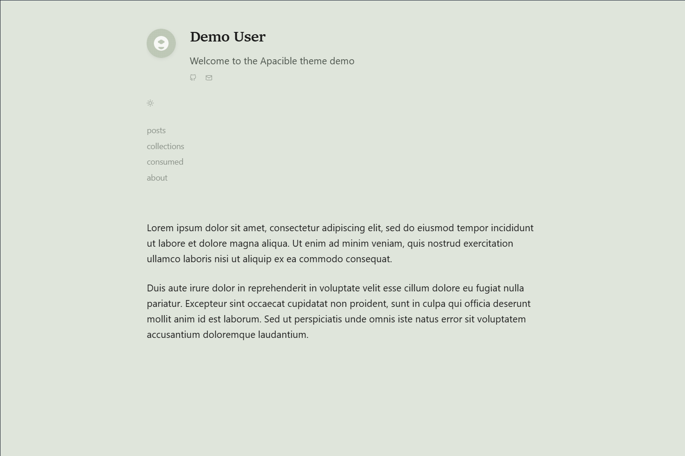

# Apacible Hugo Theme

> good-tempered, calm, pleasant

A calm Hugo theme for personal sites on the smolweb: writing, a media
journal, playlists and a linklog, with dithered images, a liquid-glass
surface and everything working without JavaScript.



## Features

- **Site header**: logo mark (home), a one-level-up crumb, the utility dock
  and a menu button that jumps to the footer index (`#site-footer`, no JS).
- **Footer index**: big rows for *writing*, *garden* and *elsewhere*
  (social links + Atom feed), then a one-line colophon with the licence.
- **Home**: hero (name, bio, dithered portrait, short about, link to `/now`),
  an *explore* index of your sections (emoji, title, description, entry
  count, latest entry on hover) and a *Lately* river of recent entries.
- **Utility dock**: command palette · colour scheme · light/dark. In the
  header on wide screens; a floating bottom dock within thumb reach on phones.
- **Command palette & site search** (<kbd>⌘K</kbd> / <kbd>Ctrl K</kbd> /
  <kbd>/</kbd>): a native `<dialog>` of real links (home nav + footer links)
  and actions (toggle theme, pick a scheme), plus full-text results from a
  [Pagefind](https://pagefind.app/) index under "Pages". Run
  `npx pagefind --site public` after `hugo` to build the index; without it the
  palette still works as a launcher. Hidden until JS runs.
- **Colour schemes**: Everforest (default), Sage, Blue, Tokyo Night, Green,
  Orange, Red, Ayu, Modus — each with light and dark variants, picked from a
  Popover-API swatch panel and remembered in `localStorage`.
- **Glass touches**: frosted glass only where a panel floats over content
  (phone dock, palette, scheme popover), plus scroll progress and reveals.
  Solid fallbacks without `backdrop-filter` and under reduced transparency.
- **Page transitions** with [swup](https://swup.js.org/) (progressive; plain
  navigation without JS).
- **Sections with dedicated layouts**: `made` (posts), `margins`
  (movies/music/books with filters, view switcher and "loved"), `picks`,
  `playlists` (mixes + optional radio calendar), `found` (linklog with
  collections), tags/categories.
- **Dithered images**: Floyd–Steinberg greys tinted by the active scheme.
- **Code** in self-hosted [Maple Mono](https://github.com/subframe7536/maple-font)
  (SIL OFL); syntax colours follow the scheme.
- **Mermaid** diagrams from ` ```mermaid ` fences; the library is only
  fetched on pages that contain a diagram and re-renders on theme change.
- **KaTeX** math (`math = true` in front matter).
- **Atom feeds** and a **Gemini** capsule (`index.gmi`) for every section.
- CSS Naked Day / JS Naked Day / Towel Day participation, optional Giscus
  comments, GoatCounter and a Netlify newsletter form.

## Requirements

- Hugo **0.156+** (verified with 0.168).
- Node.js + npm: the swup bundle is built with Hugo's `js.Build` from the
  `swup` and `@swup/head-plugin` npm packages, resolved from **your site's**
  `node_modules`.

## Installation

```bash
cd your-hugo-site
git submodule add https://github.com/christiankopac/apacible-hugo-theme themes/apacible
npm install swup @swup/head-plugin
```

Then copy `themes/apacible/exampleSite/hugo.toml` to your site root and edit
it (`theme = "apacible"`).

### Try the example site

```bash
git clone https://github.com/christiankopac/apacible-hugo-theme
cd apacible-hugo-theme/exampleSite
npm install
hugo server --themesDir ../.. --theme apacible-hugo-theme
```

## Configuration

Everything lives under `[params]`; `exampleSite/hugo.toml` is the annotated
reference. The essentials:

```toml
[minify.tdewolff.css]
precision = 0 # precision = 2 corrupts CSS numbers (1.25rem → 1.3rem)

[markup.tableOfContents]
startLevel = 2
endLevel = 4

[params]
description = "Site description"
copyright_holder = "Your Name"
footer_license = "cc-by-sa"     # cc-by | cc-by-sa | cc-by-nc | cc-by-nc-sa | cc-by-nd | cc-by-nc-nd | copyright | none
# license_url = "https://…"     # default: the Creative Commons deed
# logo = "img/logo.svg"         # SVG under assets/ for the header mark (use currentColor)
blog_section_path = "/made"

# Home "explore" index (falls back to params.sections)
[[params.home_nav]]
name = "made"      # i18n key, falls back to the literal name
path = "/made"
emoji = "🪡"       # greyscale until hover

# Footer index — the menu button's target; also the palette's "More" group
[params.footer]
writing = [{ name = "allPosts", path = "/made" }, { name = "about", path = "/about" }]
garden  = [{ name = "margins", path = "/margins" }, { name = "found", path = "/found" }]
legal   = [{ name = "privacy", path = "/privacy" }]

# Footer "Elsewhere" column
[[params.social]]
name = "GitHub"
url = "https://github.com/you"
icon = "github"    # github | bluesky | linkedin | mastodon | email | rss

# Home "Lately" river
[params.river]
enabled = true
max_items = 5
sections = ["made", "playlists", "margins", "found"]

# Margins
[params.margins]
show_view_switcher = true
show_loved = true
loved_threshold = 5   # rating ≥ N is "loved" (also /picks/ and /picks/atom.xml)
default_loved = false
```

Other params:

| Param | Default | Purpose |
| --- | --- | --- |
| `force_theme` | `false` | `"light"` / `"dark"` to pin the theme |
| `use_runes`, `rune_icons`, `toc_markers` | `true`, `false`, `false` | Runic callout icons / rune glyphs before metadata / †‡ TOC markers |
| `show_word_count`, `show_reading_time`, `show_tags_in_*`, `show_categories_in_*` | — | Post metadata |
| `date_format` | `Jan 2, 2006` | Go date layout |
| `og_image` | `/og-images/default.png` | Default Open Graph image |
| `site_url`, `gemini_url` | `baseURL`, unset | Gemini files link back to the web origin |
| `password_hash_env` | `HUGO_PASSWORD_HASH` | Env var with the sha256 for `layout = "password-protected"` pages |
| `playlists.radio` `{name, source, path}` | unset | Split `/playlists/` into mixes and a radio-broadcast calendar |
| `goatcounter.code` | unset | GoatCounter (production builds only) |
| `newsletter_enabled`, `privacy_policy_url` | `false` | Netlify newsletter form in the footer |
| `giscus_enabled`, `giscus_repo`, `giscus_repo_id`, `giscus_category`, `giscus_category_id`, `giscus_theme_url` | unset | Giscus comments (`/giscus-theme.css` matches the palette) |
| `not_found_text`, `not_found_message`, `not_found_recover_text` | — | 404 copy |

### Outputs

Atom and Gemini need their media types and output formats; copy the
`[mediaTypes]`, `[outputFormats]` and `[outputs]` blocks from
`exampleSite/hugo.toml`. An optional `Newsletter` output on the `made` section
renders that month's posts as email-ready HTML.

### Overrides and hooks

- `layouts/partials/custom_css.html`, `custom_font.html`: add your own CSS/fonts.
- `layouts/partials/backlinks.html`, `cooccurrence.html`: rendered on single
  pages when your site provides them.
- `static/img/favicon*` / `apple-touch-icon.png`: replace with your own.
- `i18n/{en,es}.toml`: every UI string; nav/footer `name`s are looked up here.

## Content

```text
content/
├── _index.md          # params: name, bio, portrait (assets path), status
├── about.md, now.md, privacy.md
├── made/              # posts: tags, categories, toc, math, featured
├── margins/{movie,music,book}/   # category, year, director/artist/author, rating, img
├── picks/_index.md    # 
├── playlists/         #  rows
└── found/             # link, via, tags, collections
```

`margins/_index.md` renders the journal with ``.

## Shortcodes

| Shortcode | Use |
| --- | --- |
| `note`, `tip`, `important`, `warning`, `caution`, `callout` | Callouts |
| `detail`, `quote`, `lastmod` | Collapsible block, quotation, last-modified date |
| `img`, `dithered`, `img_compare`, `img_gallery`, `gallery`, `spoiler-gallery` | Images — see [IMAGE_GUIDE.md](IMAGE_GUIDE.md) |
| `collection` | Cards/lists from a data file (`file="projects.toml"`) |
| `all-consumed`, `picks` | Margins journal and loved picks |
| `track` | Playlist row with Bandcamp/YouTube embed |
| `bandcamp` | Bandcamp player — see [BANDCAMP.md](BANDCAMP.md) |

Mermaid needs no shortcode: use a ` ```mermaid ` code fence.

## Smolweb

- Progressive enhancement throughout: navigation, footer index, filters and
  toggles degrade to plain HTML.
- No third-party requests except KaTeX/Mermaid (only on pages that use them)
  and opt-in analytics/comments.
- Self-hosted code font, fingerprinted per-template CSS bundles.

## License

MIT — see [LICENSE](LICENSE). Maple Mono is under the SIL OFL 1.1
(`static/fonts/maple-mono/OFL.txt`).
