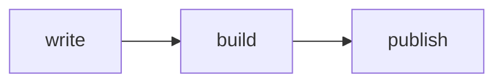

+++
title = "Hello, apacible"
date = 2026-10-01
description = "A tour of the post features."
featured = true
tags = ["theme", "hugo"]
categories = ["Notes"]
math = true
+++

## Callouts

Callouts use runes when `params.use_runes = true`.

Press <kbd>⌘K</kbd> to open the command palette.

Keep `minify.tdewolff.css.precision = 0`.

## Code

Code is set in Maple Mono.

```go
package main

import "fmt"

func main() {
	fmt.Println("good-tempered, calm, pleasant")
}
```

## Diagrams

Mermaid is only fetched on pages that contain a diagram.



## Math

Inline \(e^{i\pi} + 1 = 0\) and display:

$$
\int_0^1 x^2\,dx = \tfrac{1}{3}
$$
